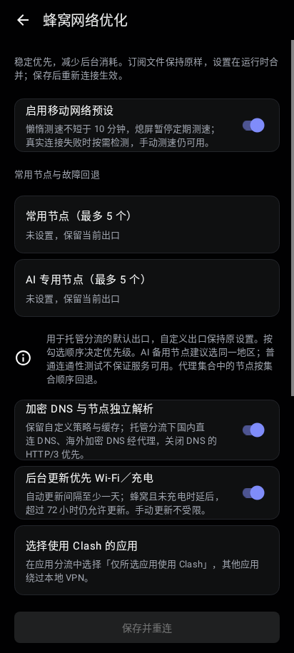

# Live Mobile 1

Version `2.11.36.Live.Mobile.1`, code 211043. Includes the Live UI redesign,
region-only live capsule, app routing and managed rule sets from previous releases.

Open **Settings → Network → 蜂窝网络优化**. The mobile preset is on by default.
Imported subscription files are unchanged; the preset is merged at runtime.

## Included

- Home traffic sampling stops when the activity is hidden.
- Live notification uses a small native selection query instead of full node lists,
  caches region labels and suppresses identical notifications. Screen-off has no
  notification timer. Manual/profile events refresh on return to the screen.
- Native Android logging filters messages before C-string allocation/dispatch.
- Periodic node checks pause while screen-off/offline/at home. Real traffic failures
  can still request a check while online, preserving background connection recovery.
- URL-test/fallback/provider checks have lazy mode and at least 600-second intervals.
- Choose up to five common nodes and five AI nodes. Managed default exits use the
  generated fallback groups; explicit custom exits remain unchanged. Static node
  priority follows selection order; provider-backed nodes follow provider ordering.
  Empty groups reject instead of silently connecting directly.
- On network return, only the current selected exit is probed. Callback bursts are
  coalesced; there is no offline retry polling loop or blanket connection reset.
- Encrypted DNS supplies independent node bootstrap. Managed domestic DNS uses one
  direct DoH server; overseas and configured AI DNS use their respective exits.
  Custom policies and explicitly configured node resolvers remain intact.
- Unreferenced old rule providers are removed from the managed runtime config;
  references preserved in DNS policies are retained.
- Automatic updates prefer unmetered networks or charging, with metered updates
  allowed after 72 hours. Enabled update intervals are no shorter than 24 hours.
  Disabled updates stay disabled; manual updates bypass deferral. Existing caches
  and bundled MRS remain usable offline.
- App routing shortcut opens the existing per-app selector; no application is
  silently added to or removed from the VPN list.

## Home Wi-Fi

Off by default. Bind your home SSID and grant precise location, **Allow all the
time**, and turn on Android Location so the SSID can be read in the background.
There is no location scanning or upload. If identity/permissions are unavailable,
the app keeps VPN routing enabled. Android VPN lockdown disables automatic pause.

On a trusted connection the service releases TUN/HTTP interception and existing
proxied connections, retaining its foreground notification and callback-based
network monitor. Leaving restores TUN without needing a background service start.
The home screen and notification explicitly show the paused state. Stop disconnects
and ends automatic management. Other Wi-Fi networks keep VPN active.



## Build and checks

The upstream submodule stays clean. A strict, reproducible Go overlay supplies
maintenance hooks; upstream changes to the hook locations fail the build.
Gradle generates this overlay automatically. For native tests:

```sh
python3 .github/scripts/mobile_core_overlay.py
GOFLAGS="-overlay=$PWD/core/build/mobile-overlay/overlay.json" \
  go -C core/src/main/golang test ./native/mobile ./native/routing -count=1
./gradlew design:testAlphaReleaseUnitTest service:testAlphaReleaseUnitTest \
  app:assembleAlphaRelease -Pcmfa.abis=arm64-v8a
```

Validation includes 17 native tests, 49 service tests and 6 Android view tests,
plus host R8 save/reopen checks for both settings stores. Previews use sample data
rendered from Android layouts, not a physical device. Real carrier handover and
ColorOS home-Wi-Fi automation still require device verification. No battery-saving
percentage is claimed. Protocol settings, MTU and IPv6 are not forcibly changed.
