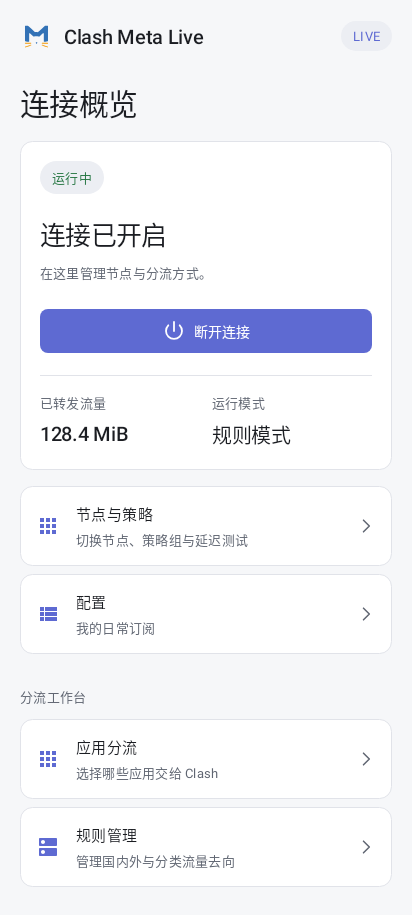
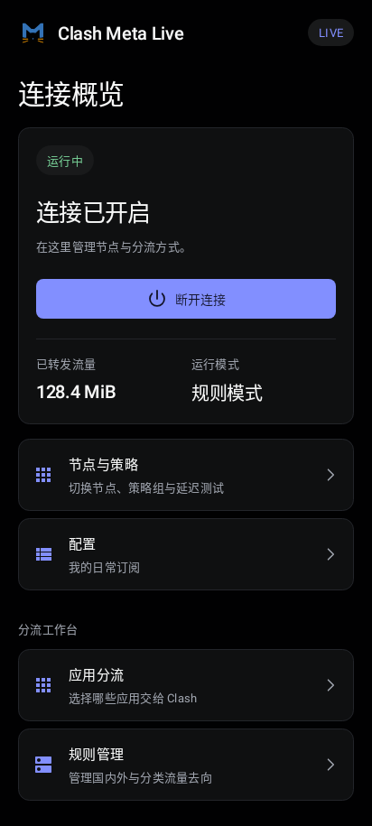
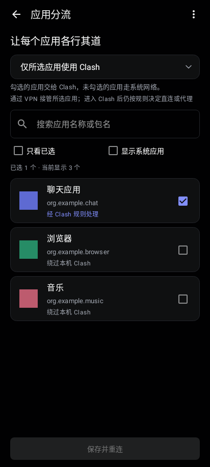
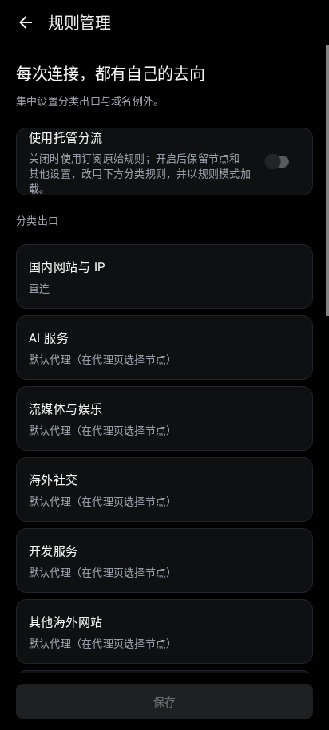

# Live UI 1

Native Kotlin/XML redesign using the Linear reference from awesome-design-md.
The adapted design tokens and interaction rules are in [DESIGN.md](../DESIGN.md).

- Connection dashboard with a clear connect/disconnect action, traffic and mode.
- Home shortcuts to app routing and managed rules.
- Consistent light/dark panels, typography, selection outlines and input focus.
- App routing keeps the existing modes, filters, bulk actions and save/reconnect.
- Landscape app routing uses independently scrolling controls beside the app list.
- Settings destinations include explanations; toolbars have 48dp touch targets.
- Existing Live Update region capsule, native routing and serialization fix remain.

## Previews

These images are rendered from the actual Android layouts using Robolectric's
native graphics. They contain sample data and are not screenshots from a phone.

| Home, light | Home, dark |
|---|---|
|  |  |

| App routing | Managed rules |
|---|---|
|  |  |

## Verification

`design:testAlphaDebugUnitTest` covers both themes, routing shortcut events,
app selection/save behavior, rule settings, landscape layout, and a 320dp screen
with 130% font scaling. PNG previews are generated in `design/build/ui-previews`.

Build and regression tasks:

```sh
./gradlew design:testAlphaDebugUnitTest service:testAlphaReleaseUnitTest \
  app:assembleAlphaRelease -Pcmfa.abis=arm64-v8a
```

The release APK uses the existing application ID and signing certificate,
version `2.11.36.Live.UI.1` (211042). Physical-device validation is still needed.
